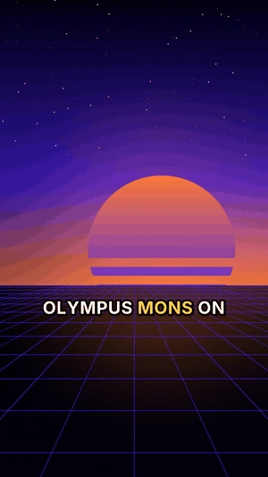

<div align="center">

# FactReel 🎬✅

**Vídeos cortos sin cara, con datos verificados y en piloto automático.**
YouTube Shorts · TikTok · Reels a partir de una lista de hechos verificados, con servicios de IA gratuitos y un plan B para todo.

[](https://github.com/DeadY2J/factreel/actions/workflows/ci.yml)
[](https://pypi.org/project/factreel/)
[](LICENSE)

[English](README.md) · [Español](README.es.md)


<br><a href="https://youtube.com/shorts/5DIG2RQZDoQ">▶ Verlo en YouTube</a> · <i>guion, voz, imágenes y subtítulos hechos por FactReel</i>

</div>

---

La mayoría de los generadores de Shorts con IA dejan que el modelo se invente cosas. **FactReel no.** Tú
escribes los hechos (con sus fuentes) una vez; la IA solo los convierte en un guion con gancho, y cada guion
pasa por controles que rechazan cifras inventadas, ideas repetidas, rumores sin avisar y cualquier cosa que
una segunda pasada de verificación no encuentre en tus hechos. Después lo narra, genera las imágenes, pone
subtítulos tipo karaoke y renderiza un MP4 vertical listo para subir.

Nace de un canal real que publica un Short cada día sin intervención, así que está hecho para **no pararse
nunca por un mal día**: si se cae la voz, la API de imágenes o la IA del guion, entra la siguiente opción.

## Qué incluye

- 🛡️ **Guionista con controles anti-invenciones**: lista blanca de cifras, detección de repeticiones,
  rumores etiquetados, verificación a temperatura 0 y un guion de reserva solo con los hechos, siempre correcto.
- 🗣️ **Cadena de voces**: voces neuronales de Microsoft Edge (gratis, sin clave) → ElevenLabs → Cloudflare
  Aura → la voz sin conexión de tu sistema. `factreel doctor` te avisa cuando un servicio cae y cuando vuelve.
- 🖼️ **Cadena de imágenes**: FLUX en Cloudflare Workers AI → FLUX en NVIDIA NIM → tu propio generador
  (GPU local, ComfyUI…) → archivo de imágenes anteriores → fondo procedural que siempre funciona sin internet.
- 💬 **Subtítulos palabra a palabra** con la palabra que suena resaltada, sincronizados con la voz o con Whisper.
- 🎞️ **Zoom Ken Burns suave y sin temblor** (render subpíxel), fundidos entre escenas, voz normalizada a
  -14 LUFS y música de fondo opcional con créditos automáticos.
- 🌍 **Español e inglés de serie** (prompts, meses, cuentas atrás). Otro idioma = un diccionario más.
- 💸 **Gratis por defecto**: funciona sin ninguna clave; todo lo de pago es opcional y con tope de gasto.
- 🔌 **Cualquier LLM compatible con OpenAI**: NVIDIA NIM, OpenRouter, Groq, OpenAI, Ollama, LM Studio, OmniRoute…
- 📤 **Subida a YouTube opcional** marcando el contenido como "alterado o sintético", como exige YouTube.
- ✅ **Comprueba cada vídeo** (resolución, audio, sin pantalla negra) antes de dejarlo en la cola de subida.

## Empezar

Necesitas **Python 3.10+** y **[FFmpeg](https://ffmpeg.org/download.html)** en el PATH.

```bash
pip install factreel
factreel init mi-canal --lang es
cd mi-canal
factreel doctor        # comprueba FFmpeg, claves y cada voz
factreel make          # -> output/20261020_180000_dia_venus.mp4 (+ metadatos .json/.txt)
```

Sin ninguna clave ya sale un vídeo con la voz gratuita de Edge, los hechos leídos tal cual y fondos sin
conexión. Añade claves gratuitas en `.env` para tener guion e imágenes con IA:

| Clave | Qué activa | Coste |
| --- | --- | --- |
| `NVIDIA_API_KEY` ([build.nvidia.com](https://build.nvidia.com)) | guion con IA + verificación, imágenes FLUX | créditos gratis |
| `CLOUDFLARE_ACCOUNT_ID` + `CLOUDFLARE_API_TOKEN` | imágenes FLUX, voz de reserva, tiempos exactos de subtítulos (Whisper) | 10.000 neurons gratis al día, con tope |
| `ELEVENLABS_API_KEY` | voz premium | opcional |

## Tus hechos

```json
{
  "topics": [
    {
      "id": "dia_venus",
      "angle": "en Venus un día dura más que un año",
      "facts": [
        "Venus tarda unos 243 días terrestres en dar una vuelta sobre sí mismo.",
        "Venus tarda unos 225 días terrestres en dar una vuelta al Sol."
      ],
      "sources": ["https://science.nasa.gov/venus/venus-facts/"],
      "hashtags": ["#venus"],
      "weight": 2
    }
  ]
}
```

Empieza por `RUMOR:` las noticias sin confirmar y el guion tendrá que decirlo. Pon ids de temas en
`queue.txt` para elegir qué sale después; si no, se elige el tema menos usado (`weight` > 1 = más a menudo).

## Comandos

| Comando | Qué hace |
| --- | --- |
| `factreel init CARPETA --lang es` | crea un canal desde una plantilla |
| `factreel make [-t TEMA] [-n 3]` | genera vídeos en `output/` |
| `factreel make --offline --voice dummy` | vista previa al instante: sin IA, voz muda, imágenes sin conexión |
| `factreel topics` | temas y cuántas veces se ha usado cada uno |
| `factreel doctor [--voices --log]` | lo comprueba todo; `--log` es ideal para una tarea programada |
| `factreel upload [--privacy unlisted]` | sube los vídeos pendientes a YouTube (`pip install "factreel[youtube]"`) |
| `factreel run` | genera y sube, para la tarea programada diaria |

## Documentación

- [Configuración](docs/configuration.md) · [Proveedores](docs/providers.md) · [Subida a YouTube](docs/youtube.md) · [Programar tareas](docs/scheduling.md) (en inglés)

## Uso responsable

FactReel declara el contenido generado con IA al subirlo, no se inventa datos y etiqueta los rumores.
Mantenlo así: cita tus fuentes, respeta marcas y licencias de música y no lo uses para producir en masa
contenido engañoso. Las plataformas penalizan el spam; buenos datos hacen buenos vídeos.

## Contribuir

¡Las contribuciones son muy bienvenidas!, sobre todo idiomas nuevos, proveedores de voz e imagen y
subidas a otras plataformas. Mira [CONTRIBUTING.md](CONTRIBUTING.md) y la [hoja de ruta](ROADMAP.md).
Puedes escribir las issues y los PR en español o en inglés.

## Licencia

[MIT](LICENSE) © Jorge Lamelas
