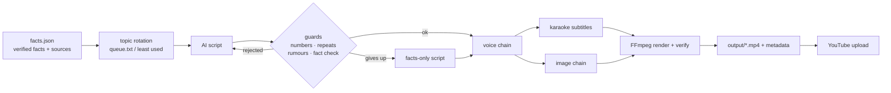

<div align="center">

# FactReel 🎬✅

**Fact-checked faceless short videos, on autopilot.**
YouTube Shorts · TikTok · Reels, from a list of verified facts, with free AI services and a fallback for everything.

[](https://github.com/DeadY2J/factreel/actions/workflows/ci.yml)
[](https://pypi.org/project/factreel/)
[](https://pypi.org/project/factreel/)
[](LICENSE)

[English](README.md) · [Español](README.es.md)


</div>

---

Most "AI shorts generators" let a language model make things up. **FactReel doesn't.** You write the facts
(with sources) once; the AI only turns them into a punchy script, and every script goes through guards that
reject invented numbers, repeated ideas, unlabelled rumours and anything a second fact-checking pass can't
find in your facts. Then it narrates it, draws the images, burns karaoke subtitles and renders a vertical
MP4 ready to upload.

It grew out of a real channel that publishes a Short every day unattended, so it is built to **never stop
on a bad day**: if the voice service, the image API or the script AI is down, the next option in the chain
takes over.

## Features

- 🛡️ **Anti-hallucination script writer**: number whitelist, repetition check, rumour labelling, a
  temperature-0 fact-check pass, and a facts-only fallback that is always correct.
- 🗣️ **Voice fallback chain**: Microsoft Edge neural voices (free, no key) → ElevenLabs → Cloudflare
  Aura → your OS's offline voice. `factreel doctor` tells you when a service is down and when it is back.
- 🖼️ **Image fallback chain**: Cloudflare Workers AI FLUX → NVIDIA NIM FLUX → your own generator
  (local GPU, ComfyUI…) → archive of previous images → procedural background that always works offline.
- 💬 **Word-by-word subtitles** with the spoken word highlighted, synced from the TTS engine or Whisper.
- 🎞️ **Smooth Ken Burns zoom without jitter** (sub-pixel rendering), cross-fades on scene changes,
  voice normalised to -14 LUFS, optional background music with automatic credits.
- 🌍 **Spanish and English first-class** (prompts, month names, countdowns). More languages = one dict.
- 💸 **Free by default**: runs with zero API keys; every paid service is optional and budget-capped.
- 🔌 **Any OpenAI-compatible LLM**: NVIDIA NIM, OpenRouter, Groq, OpenAI, Ollama, LM Studio, OmniRoute…
- 📤 **Optional YouTube upload** with the "altered or synthetic content" flag set for you.
- ✅ **Verifies every render** (resolution, audio, no black screen) before it reaches the upload queue.

## Quick start

You need **Python 3.10+** and **[FFmpeg](https://ffmpeg.org/download.html)** on your PATH.

```bash
pip install factreel
factreel init my-channel --lang en      # or --lang es
cd my-channel
factreel doctor                         # checks FFmpeg, keys and every voice
factreel make                           # -> output/20261020_180000_venus_day.mp4 (+ .json/.txt metadata)
```

That's it: with no keys at all you get a video with the free Edge voice, the facts read as they are and
offline backgrounds. Add free keys to `.env` to unlock the AI script and AI images:

| Key | What it unlocks | Cost |
| --- | --- | --- |
| `NVIDIA_API_KEY` ([build.nvidia.com](https://build.nvidia.com)) | AI script + fact check, FLUX images | free credits |
| `CLOUDFLARE_ACCOUNT_ID` + `CLOUDFLARE_API_TOKEN` | FLUX images, backup voice, exact subtitle timing (Whisper) | 10,000 free neurons/day, capped |
| `ELEVENLABS_API_KEY` | premium voice | optional |

## How it works



## Your facts

```json
{
  "topics": [
    {
      "id": "venus_day",
      "angle": "a day on Venus is longer than its year",
      "facts": [
        "Venus takes about 243 Earth days to spin once on its axis.",
        "Venus takes about 225 Earth days to orbit the Sun."
      ],
      "sources": ["https://science.nasa.gov/venus/venus-facts/"],
      "hashtags": ["#venus"],
      "weight": 2
    }
  ]
}
```

Prefix unconfirmed news with `RUMOR:` and the script will be forced to say so. Put topic ids in
`queue.txt` to choose what goes out next; otherwise the least used topic is picked (`weight` > 1 = more often).

## Commands

| Command | What it does |
| --- | --- |
| `factreel init DIR --lang es` | new channel folder from a template |
| `factreel make [-t TOPIC] [-n 3]` | generate videos into `output/` |
| `factreel make --offline --voice dummy` | instant preview: no AI, silent voice, offline images |
| `factreel topics` | topics and how many times each was used |
| `factreel doctor [--voices --log]` | check everything; `--log` is perfect for a scheduled task |
| `factreel upload [--privacy unlisted]` | upload pending videos to YouTube (`pip install "factreel[youtube]"`) |
| `factreel run` | make + upload, for a daily scheduled task |

## Documentation

- [Configuration reference](docs/configuration.md): every `channel.toml` option
- [Providers](docs/providers.md): voices, images, LLMs and how to add your own
- [YouTube upload](docs/youtube.md): OAuth setup in 5 minutes
- [Scheduling](docs/scheduling.md): Windows Task Scheduler, cron, GitHub Actions

## Responsible use

FactReel declares AI-generated media when uploading, never invents facts on its own, and labels rumours.
Please keep it that way: cite your sources, respect trademarks and music licences, and don't use it to
mass-produce misleading content. Platforms penalise low-effort spam; good facts make good videos.

## Contributing

Contributions are very welcome, especially new languages, voice/image providers and platform uploaders.
See [CONTRIBUTING.md](CONTRIBUTING.md) and the [roadmap](ROADMAP.md) for good first issues.

## License

[MIT](LICENSE) © Jorge Lamelas
